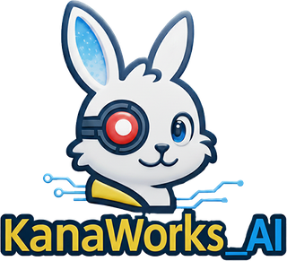

# effekseer-vfx-skill

<div align="center">


<p>
  <a href="LICENSE"></a>
  <a href="https://agentskills.io"></a>
  
  
  
  <a href="https://github.com/kanaworksai-hue/effekseer-vfx-skill/stargazers"></a>
</p>

<p><a href="https://github.com/kanaworksai-hue"></a>&nbsp;<a href="https://github.com/kanaworksai-hue"><b>KanaWorks_AI 프로젝트</b></a></p>

[English](README.md) | [简体中文](README.zh-CN.md) | [日本語](README.ja.md) | 한국어 | [Português (Brasil)](README.pt-BR.md) | [Español](README.es.md)

</div>

> 이 문서는 영어 README의 번역본입니다. 에이전트가 실제로 불러오는 것은 `skills/` 아래의 영어 파일이며, 내용이 서로 다를 경우 영어판이 우선합니다.

코딩 에이전트(Claude Code, Codex, Cursor, Gemini CLI, GitHub Copilot, OpenCode 및 기타
[Agent Skills](https://agentskills.io) 호스트)가 VFX 아티스트가 반복 작업하는 방식 그대로, 실시간 게임 VFX를 코드로 만들 수 있게 해 주는 에이전트 스킬입니다.

**디자인 브리프 → 텍스처 → Python 레시피 → EffekseerCore 빌드 → 실제 Godot 필름스트립 → 확인 → 한 가지만 수정 → 반복 → 독립 리뷰**

- **`effekseer-vfx`** — 제작 스킬. 크래프트 규칙, 실측으로 검증한 Effekseer/Godot 엔진 규약, 조합해서 쓰는 약 30개의
  레이어 프리미티브, 정적 린터, save/open 리드백 검증이 포함된 공식 EffekseerCore 컴파일러, 모든 이펙트를 두 더미 사이의
  주고받기로 연출하는 Godot Lab, 픽셀 플래그가 붙는 필름스트립 캡처, 반복 이력, 그리고 리뷰를 그 리뷰가 실제로 본 빌드와
  정확히 묶어 주는 변조 감지 가능한 증거 기록을 갖추고 있습니다.
- **`vfx-review`** — 리뷰어 스킬. 작성자는 자기 작업을 채점하지 않으므로, 별도의 에이전트가 레시피를 보지 않은 채 고정된
  평가 기준으로 스트립을 채점합니다.
- **예제** — 브리프와 텍스처가 포함된 완성 이펙트 16종: 원거리 페어 4쌍(화염, 얼음, 독, 암흑: 투사체 + 착탄),
  히트·베기·차지·실드·힐 각 1종, 그리고 괴수 세트(등지느러미 골판을 타고 올라가는 차지, 휩쓸 수 있는 원자 빔,
  실사풍 폭발). 여기에 진단 전후 비교 사례 3건이 더해집니다.
- **대형·실사풍 이펙트** — `scale='kaiju'`는 캐릭터 스케일 레시피를 40배 크고 2.5배 느리게 빌드합니다
  (크기, 속도, 중력, 예산, 리뷰 카메라가 모두 따라 바뀝니다). `beam()`은 게임이 매 프레임 끝점을 움직이는
  유지형 빔을 만듭니다(`Vfx.beam()` → `aim()` → `release()`). `charge_chain()`은 점들의 연결을 따라 아크를
  점등합니다. 실사풍 화염·그을음·연기 플립북, Forward+에서 검증된 소프트 파티클도 포함됩니다.
- **콤보, 블록아웃, 스타일라이즈드 형태** — 시퀀스 브리프는 여러 이펙트를 캐릭터 애니메이션의 박자에 묶고,
  블록아웃 → 디테일 → 폴리시 순서로 작업을 관문화합니다(텍스처 작업 전에 독립 블록아웃 리뷰를 통과해야 합니다).
  캡처는 게임 자체에서 가져올 수 있고, 레퍼런스에는 리뷰어가 확인하는 '가져올 것' 목록이 붙으며, `vfx
  paintover`는 캡처한 프레임을 콘셉트 목표용 이미지 편집 프롬프트로 바꿉니다. 하드 엣지 스타일라이즈드 프리미티브
  (`spiral_ribbons`, `spike_crown`, `speed_streaks`, `stylized_pair`, `sparkle`), 그레이스케일 마스크 템플릿, 그리고
  화면 피드백(`screen=`: 셰이크, 임팩트 프레임, 히트스톱)을 제공하며, 화면 피드백은 Lab이 재생하고 `Vfx.screen_cue`가 게임에 전달합니다.

## 이펙트를 만드는 세 가지 방법 (0.3 신기능)

이펙트마다 고를 수 있으며, 어느 한 방법을 강제하지 않습니다.

| 방법 | 방식 | 재생 환경 |
|---|---|---|
| **프로시저럴** | Python 레시피에서 프리미티브를 레이어로 쌓고, 페인팅한 텍스처를 쓰고, EffekseerCore로 빌드하고, Godot에서 리뷰(위에서 설명한 전부) | Effekseer → Godot |
| **비디오 플립북** | 이미지-투-비디오 모델(Seedance 2.5로 검증, 첫 프레임과 마지막 프레임을 지정할 수 있는 모델이면 무엇이든 가능)이 검은 배경 위에 움직임을 그리고, `vfx video-flipbook`이 키잉·크롭·마스킹·시트 패킹을 하며, `vfx video-grade`가 한 속성의 모든 시트에 같은 셀 셰이딩 룩을 입힙니다 | Unity (URP), 또는 Effekseer → Godot |
| **조합** | 시트를 레시피의 본체 레이어(`video_body(...)`)로 쓰고, 접촉 플래시·스파크·링·균열·데칼·열 아지랑이는 프리미티브로 더합니다 | Effekseer → Godot, Unity |

**예전에는 불가능했지만 이제 가능한 것:**

- **연속적인 형태 변화.** 솟구친 물기둥이 대상을 공중으로 띄웠다가 비가 되어 무너져 내리고,
  화염구가 터지며 회색 연기로 끓어오르고, 불꽃이 휘몰아치는 구체가 이음매 없이 루프합니다. 프리미티브는 그림을 스케일·페이드·스크롤·침식할 수는 있어도
  하나의 실루엣 안에서 불을 연기로 바꿀 수는 없습니다. 비디오 모델은 그 사이의 모든 중간 프레임을 그려 줍니다.
- **움직이는 손그림 애니메이션 룩을 속성 세트 전체에 일관되게.** 속성마다 하나의 명도 램프로
  모든 시트를 같은 평면 단계(어두운 테두리, 본체, 밝은 부분, 뜨거운 코어)로 그레이딩합니다.
- **Unity.** 이전에는 Godot까지만 지원했습니다. `vfx unity-install <UnityProject>`는 URP 런타임 패키지
  (투사체·즉발 볼트·지면 분출 방식의 발동을 지원하는 데이터 기반 `ElementProfile` 스킬, 레이어드 파티클,
  히트스톱, 셰이크, 대상 띄우기)와 그 프로시저럴 텍스처를 추가합니다. `vfx unity-export`는 시트를 그리드 정보와 함께 복사하고,
  메뉴 항목 3개(또는 에이전트가 실행할 수 있는 배치 모드 명령 1개)로 시트를 플레이 가능한 스킬과 데모 씬으로 만듭니다.
- **한 문장으로 재현 가능.** 모든 클립의 프롬프트와 모든 시트의 파라미터가
  `vfx/video_prompts.json`에 기록되므로, 에이전트가 시트를 정확히 다시 만들거나 변형할 수 있습니다. 이렇게 요청해 보세요: *"비디오 플립북으로
  물기둥 스킬을 만들어서 내 Unity 프로젝트에 세팅해 줘."*

가이드: [`references/video-flipbook.md`](skills/effekseer-vfx/references/video-flipbook.md). 이 스킬이 배포하는 것은
기법뿐이며, 여러분이 생성한 클립·시트·캐릭터는 여러분의 프로젝트에 남습니다.

## 요구 사항

| 모드 | 할 수 있는 일 | 필요한 것 |
|---|---|---|
| authoring | 브리프와 레시피 작성, 린트, 텍스처 처리 및 측정 | macOS, Linux 또는 Windows의 Python 3.11+ 또는 [uv](https://docs.astral.sh/uv/) (macOS 기본 Python 3.9는 너무 오래됨) |
| build | 공식 EffekseerCore로 `.efkefc` / `.efk` 컴파일 | **Apple silicon macOS** 또는 **Windows x64**, 최초 설치 시 네트워크 연결(`~/.cache/effekseer-vfx`에 약 250 MB) |
| render | Godot 필름스트립 리뷰, Lab, 프리뷰, 패키징 | 위의 항목 + `PATH`에 있거나 `GODOT`로 지정한 [Godot 4](https://godotengine.org) (Forward+), 레퍼런스 클립과 녹화에는 `ffmpeg` |
| 비디오 플립북 | `video-*` 명령 | authoring 모드 + `ffmpeg`, 클립은 어떤 이미지-투-비디오 모델에서 만들어도 됨 |
| Unity | 시트를 속성 스킬로 재생 | URP 17이 포함된 Unity 6 (6000.0+), 6000.5에서 검증됨 |

build와 render는 macOS ARM64(Effekseer Core 1.80.7, EffekseerForGodot4 1.80.5.1, Godot 4.7, .NET 9)와
Windows 11 x64(같은 버전, Godot 4.7.2)에서 검증되었습니다. Windows ARM64는 설치 과정에서 맞는 .NET 런타임을 받지만
검증되지는 않았습니다. Linux는 authoring 모드로 동작하며, build 경로는 검증되지 않았습니다.

Windows에서는 아래의 모든 `sh <skill>/scripts/...` 명령이 Git Bash(Claude Code가 사용하는 셸)에서도 동작합니다. cmd나
PowerShell에서는 `vfx` 대신 `<skill>\scripts\vfx.cmd`를, `setup.sh` 대신
`powershell -NoProfile -ExecutionPolicy Bypass -File <skill>\scripts\setup.ps1`을 사용하세요.

## 설치

가장 간단한 방법: 이 저장소의 URL을 코딩 에이전트에게 주고 스킬 설치를 요청하세요. 에이전트가
따르는 절차는 [에이전트용: 이 URL에서 설치하기](#에이전트용-이-url에서-설치하기)에 있습니다. 직접 설치할 수도 있습니다.

**Claude Code** (Claude Code에서 입력)

```text
/plugin marketplace add kanaworksai-hue/effekseer-vfx-skill
/plugin install effekseer-vfx@effekseer-vfx
```

**Codex** (Codex 채팅에서 요청합니다. 스킬은 `~/.codex/skills` 또는 `$CODEX_HOME/skills`에 설치되며,
다음 턴이나 새 세션부터 사용됩니다)

```text
$skill-installer install https://github.com/kanaworksai-hue/effekseer-vfx-skill/tree/main/skills/effekseer-vfx
$skill-installer install https://github.com/kanaworksai-hue/effekseer-vfx-skill/tree/main/skills/vfx-review
```

**기타 에이전트** (Cursor, Gemini CLI, Copilot, OpenCode, ...)

```sh
npx skills add kanaworksai-hue/effekseer-vfx-skill
```

또는 `skills/effekseer-vfx`와 `skills/vfx-review`를 에이전트의 스킬 폴더(`~/.claude/skills/`,
`.agents/skills/`, ...)에 복사하세요. 각 스킬 폴더에는
자체 `LICENSE`(그리고 `effekseer-vfx`에는 `THIRD_PARTY_NOTICES.md`)가 들어 있어, 폴더만 복사해도 함께 유지됩니다.

### 에이전트용: 이 URL에서 설치하기

1. **파일을 받는다.** 호스트에 플러그인 또는 스킬 설치 도구가 있다면 그것을 우선 사용합니다(위의 명령). `/plugin` 같은
   슬래시 명령은 사용자가 직접 입력해야 하므로 사용자에게 보여 줍니다. 그렇지 않으면 저장소를 클론하고 두 스킬
   폴더를 이름 그대로 스킬 폴더에 복사합니다: `git clone --depth 1 <이 저장소의 URL>` 후
   `skills/effekseer-vfx`와 `skills/vfx-review`를 `~/.claude/skills/`(Claude Code, 모든 프로젝트),
   `<project>/.claude/skills/`(Claude Code, 단일 프로젝트), `~/.codex/skills/`(Codex, 설정되어 있으면 `$CODEX_HOME/skills`) 또는
   호스트의 스킬 폴더(예: `.agents/skills/`)에 복사합니다.
   그 밖의 것은 복사하지 않습니다. 스킬은 자기 완결적이며 실행 시에는 읽기 전용입니다.
2. **불러온다.** 스킬 목록에 아직 스킬이 보이지 않으면 사용자에게 새 세션을 시작해 달라고 요청합니다.
3. **머신을 점검한다.** 사용자의 게임 프로젝트에서 `sh <skill>/scripts/vfx doctor`를 실행하고(`<skill>`은
   설치된 `effekseer-vfx` 폴더, Git Bash가 아닌 Windows 환경에서는 `<skill>\scripts\vfx.cmd doctor`) 그
   `next` 단계를 따릅니다.
4. **다운로드 전에 묻는다.** `sh <skill>/scripts/setup.sh`(Windows는 `setup.ps1`, 정확한 명령은
   `doctor`의 `next`에 있습니다)는 툴체인을 `~/.cache/effekseer-vfx`에 설치합니다
   (macOS ARM64와 Windows x64에서 약 250 MB, 그 외 환경에서는 `--authoring-only`). 또한 첫 `vfx init`은 공식
   Effekseer Godot 플러그인(약 34 MB)을 다운로드합니다. 설치에는 Python 3.11+ 또는 uv가 필요합니다. `doctor`가 둘 다 없다고 보고하면 사용자에게
   하나를 설치해 달라고 요청합니다. Godot 4는 절대 사용자 대신 설치하지 않습니다. 사용자에게 설치를 요청하거나(또는 대신 설치해도 되는지
   허락을 받고), `PATH`에 없으면 `GODOT`을 설정해 달라고 요청합니다.
5. **Godot은 샌드박스 밖에서 실행한다.** `vfx review`, `preview`, `showcase`는 사용자의 데스크톱에 Godot 창을
   엽니다. 샌드박스 안의 에이전트(예: 워크스페이스 샌드박스 안의 Codex)는 창을 열 수 없으므로, 이 명령들은
   사용자의 승인을 받아 샌드박스 밖에서 실행합니다. 호스트가 샌드박스를 벗어날 수 없다면 사용자가 데스크톱 터미널에서 실행할 수 있도록
   정확한 명령을 전달합니다. 프레임을 하나도 렌더링하지 못한 리뷰는 약 90초 후 "rendered no frame"으로 중단됩니다
   (창을 열지 못했을 가능성이 가장 높으니, 함께 출력되는 Godot 로그를 확인하세요). `doctor`의 `render: true`는
   Godot을 찾았다는 의미일 뿐입니다.
6. **동작을 확인한다.** `vfx doctor`를 다시 실행하고(`modes`에 이 머신이 지원하는 기능이 표시됩니다)
   [시작하기](#시작하기)를 따릅니다. 동작하는 것과 부족한 것을 보고하고, `doctor`가 build나 render를 지원하지 않는다고 하는
   머신에서 그것이 동작한다고 주장하지 않습니다.

## 시작하기

게임 프로젝트에서 에이전트에게 이렇게 요청하세요: *"여기에 effekseer-vfx 스킬을 세팅하고 화염 예제를 보여 줘."* 에이전트는 다음을 실행합니다.

```sh
sh <skill>/scripts/vfx doctor            # what this machine can do, and what to install
sh <skill>/scripts/setup.sh              # macOS ARM64 / Windows x64; use --authoring-only elsewhere (asks you first)
sh <skill>/scripts/vfx init              # creates vfx/ with the Godot Lab, materials and math textures
sh <skill>/scripts/vfx examples add fire
sh <skill>/scripts/vfx build --ids VFX_Projectile_Fire VFX_Fire_Explosion
sh <skill>/scripts/vfx review --ids VFX_Projectile_Fire VFX_Fire_Explosion --note "baseline"
sh <skill>/scripts/vfx showcase          # play the library in the Lab
```

그다음 이펙트를 요청하세요: *"타깃 지정 주문에 쓸 낙뢰를 만들어 줘. 짧고 날카롭게, 리턴 스트로크도 넣어서."* 이
스킬에 따라 에이전트는 브리프를 작성하고, 여러분의 이미지 생성 도구에 페인팅 텍스처를 요청하고(또는 여러분에게
준비를 부탁하고), 레시피를 작성해 빌드하고, 여러 라운드에 걸쳐 스트립을 리뷰한 뒤, 결과를 독립 리뷰어에게 넘기고 나서야
`effect-verify` 통과를 보고합니다. 독립 리뷰가 제출되고 `vfx overview`를 다시 실행하기 전까지는, 이펙트가 올바르게 렌더링되더라도
`effect-verify`가 `verified: false`를 표시합니다. 이 시점에서 에이전트는 "검증됨"이 아니라
"빌드와 렌더링이 된다"고 보고해야 합니다. 툴체인은 `~/.cache/effekseer-vfx`에 있으며, 다른 곳에 두려면
`EFFEKSEER_VFX_HOME`을 설정하세요([명령 레퍼런스](skills/effekseer-vfx/references/cli.md) 참조).

## 이미지 생성

복잡한 페인팅 형태(연기, 베기 궤적, 화염, 균열, 얼음, 문양)는 반드시 이미지 생성 모델에서 만들어야 하며,
이 스킬은 결코 코드로 흉내 내지 않습니다. 에이전트에 내장되었거나 연결된 이미지 도구가 있으면, `vfx/texture_prompts.json`에
기록한 프롬프트로 그 도구를 사용합니다. 없으면 어떤 이미지를 생성해 어디에 저장해야 하는지 정확히 알려 줍니다.
수학적 형태(글로우, 링, 노이즈, 그라디언트, 트레일, 디스토션 맵)는 프로시저럴로 생성됩니다.

## 게임에서 이펙트 사용하기

이펙트는 최종적으로 `.efk` 런타임 익스포트와 `.efkefc` 소스, 그리고 `vfx_manifest.json`으로 출력됩니다. 생성된 Godot 프로젝트에는
작은 API가 들어 있습니다.

```gdscript
var handle = Vfx.play("VFX_Fire_Explosion", position)
var shot = Vfx.launch("VFX_Projectile_Fire", from, to)
shot.arrived.connect(func(at): Vfx.play("VFX_Fire_Explosion", at))
```

빔은 매 프레임 조준하며, 끝점(레이캐스트, 타깃 본)은 게임이 관리합니다.

```gdscript
var ray = Vfx.beam("VFX_Kaiju_Atomic_Beam", mouth, target)
ray.aim(mouth, new_target)   # each frame: sweep, follow the head
ray.release()                # narrows and fades out, then frees itself
```

[`skills/effekseer-vfx/references/godot.md`](skills/effekseer-vfx/references/godot.md)를 참조하고, 거인과 괴수에 대해서는
[`references/scale.md`](skills/effekseer-vfx/references/scale.md)도 참조하세요.

## 저장소 구조

```
skills/effekseer-vfx/      SKILL.md, references/ (craft, engine conventions, review...), scripts/ (vfx CLI and vfx.cmd,
                           setup.sh and setup.ps1, vfxkit, vendored effekseer_ai), assets/ (Godot Lab, materials, rubric,
                           brief schema, examples, unity/ URP package)
skills/vfx-review/         SKILL.md for the independent reviewer
docs/zh/, docs/ja/         Chinese and Japanese translations of the references
.claude-plugin/            Claude Code plugin and marketplace manifests
tests/                     pure-Python tests (no Core or Godot needed)
```

## 제한 사항

- 리뷰 지표는 실제 뷰포트에 대한 픽셀 휴리스틱이며, GPU나 오버드로를 측정한 값이 아닙니다.
- 리뷰 하네스는 macOS와 Windows에서 창 모드 Godot을 구동합니다. 헤드리스 Linux 캡처는 아직 지원하지 않습니다.
  Windows에서는 캡처하는 동안 Godot 창이 포커스를 유지합니다(macOS는 포커스를 사용 중인 앱으로 되돌려 줍니다).
- Windows에서 심볼릭 링크 안전성 테스트는 개발자 모드(또는 관리자 셸)가 필요하며, 없으면 건너뜁니다.
- 예제 점수는 스킬 자체의 캡슐 Lab 렌더에 대한 독립 리뷰 결과입니다(16종 중 2종은
  `iterate` 판정). 이 점수에 의존하기 전에 다시 빌드하고 리뷰하세요.
- `soft` 파티클은 Forward+에서 검증되었습니다(불투명 깊이에 대해서만 페이드됩니다). Compatibility 렌더러에는
  깊이 텍스처가 없어 사용할 수 없습니다.

## 개발

```sh
sh skills/effekseer-vfx/scripts/setup.sh --authoring-only
~/.cache/effekseer-vfx/venv/bin/python -m pip install pytest
~/.cache/effekseer-vfx/venv/bin/python -m pytest -q tests
```

Windows의 경우(PowerShell, `--authoring-only`를 빼면 EffekseerCore 빌드 테스트도 실행됩니다):

```powershell
powershell -NoProfile -ExecutionPolicy Bypass -File skills\effekseer-vfx\scripts\setup.ps1 --authoring-only
~\.cache\effekseer-vfx\venv\Scripts\python.exe -m pip install pytest   # a venv made by uv: uv pip install --python <that python.exe> pytest
~\.cache\effekseer-vfx\venv\Scripts\python.exe -X utf8 -m pytest -q tests
```

새로운 엔진 규약을 확인한 기여에서는 그 규약을 측정 방법과 함께
`skills/effekseer-vfx/references/engine-conventions.md`에 추가해 주세요.

## 라이선스와 크레딧

- **이 프로젝트:** [MIT](LICENSE). 코드 사본에 저작권 표시와 라이선스 문구를 남기면 상업적 용도를 포함해 자유롭게 사용·수정·배포할 수 있습니다.
- **직접 만든 것:** 여러분의 프로젝트에서 만든 이펙트, 텍스처, 플립북, Unity 스킬은 여러분의 것입니다. 이 저장소는 어떤 권리도 주장하지 않습니다.
- **비디오·이미지 모델:** 생성한 클립과 이미지(예: Seedance 2.5)에는 이 라이선스가 아니라 해당 모델의 이용 약관이 적용됩니다. 상업적으로 사용하기 전에 확인하세요. 이 저장소는 생성물을 배포하지 않습니다.
- **서드파티 구성 요소:** Effekseer, EffekseerForGodot4, .NET, 포함된 effekseer-ai는 각자의 라이선스를 따릅니다. [THIRD_PARTY_NOTICES.md](THIRD_PARTY_NOTICES.md)를 참조하세요.
- **브랜드와 예시:** KanaWorks_AI 이름, 로고, Kana 캐릭터의 권리는 東京AI映像合同会社(Tokyo AI Visuals LLC)에 있으며 MIT 라이선스의 대상이 **아닙니다**. 배너와 홍보 영상의 이펙트, 캐릭터, 영상은 예시이며 저장소에 포함되지 않고 라이선스 대상도 아닙니다. [docs/brand](docs/brand/README.md)를 참조하세요.

Effekseer, Godot, Unity는 각 소유자의 상표입니다. 이 프로젝트는 독립 프로젝트이며 이들과 제휴하거나 승인을 받지 않았습니다.

<br>

<div align="center">

<a href="https://x.com/KanaWorks_AI"></a>

<p><b>Made with ♥ by <a href="https://x.com/KanaWorks_AI">KanaWorks_AI</a></b> · <a href="https://x.com/KanaWorks_AI">@KanaWorks_AI</a> on X</p>

<p><sub>도움이 되었다면 ⭐를 눌러 주세요. 업데이트를 이어 가는 힘이 되고 다른 사람들도 찾기 쉬워집니다. 다른 프로젝트: <a href="https://github.com/kanaworksai-hue">github.com/kanaworksai-hue</a></sub></p>

</div>
