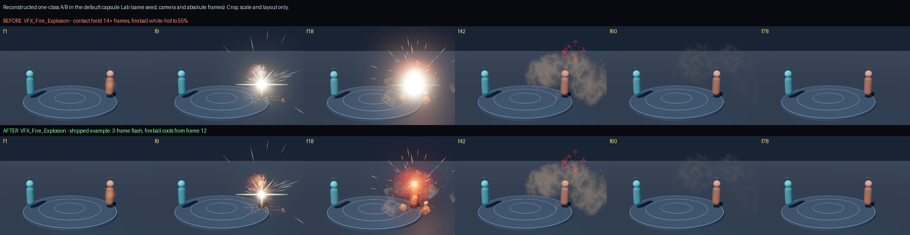
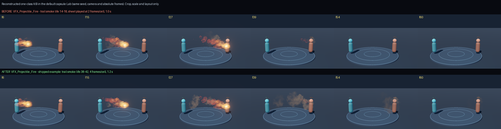
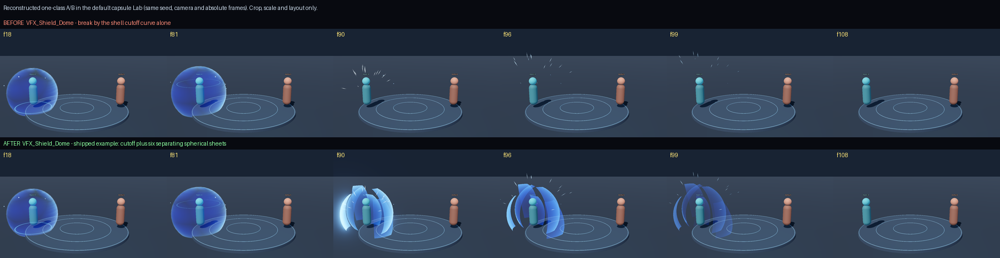

# Diagnosed cases

Three before/after lessons, each a **reconstructed one-class A/B**: the shipped example was changed back to a known
failure in one class of problem, both versions were rendered in the skill's default capsule Lab with the same seed,
camera and absolute frames, and the real frames were only cropped, scaled and laid out. Provenance (evidence IDs and
frame hashes of both captures) is in [case_images/cases.json](case_images/cases.json). The failures themselves come
from earlier iterations of these effects; the images are new renders, not the historical ones.

Cases never replace `vfx effect-verify` for your build. Name the visible problem first, then pick one class of fix;
do not copy the final parameters into every effect. Pick the case that matches the current worst criterion: white
blob → explosion; trail exit → projectile; parameters written but the shape does not change → shield. To reproduce
one, `vfx examples add` the example, make the BEFORE change, `vfx review`, undo it and review again: the second round
writes the same comparison as `<ID>_compare.png`.

## Fire explosion: a contact that stays white

**BEFORE:** the Detonation flash lives 14 frames instead of 3, the Fire core 22 instead of 5, and the Fireball's ramp
holds white until 55 % of its life instead of turning orange at 12 %. **Look at f18.** BEFORE is still one white
disc that hides the fireball's shape and the target; AFTER has already cooled to an orange-red body with a hot centre,
so the saturated shape, the debris and the lopsided throw read. f42–78 are nearly identical: the fault is only in the
contact. Lint warns about the 14-frame flash (`contact should be 2-5`); the strip shows why.

| Visible problem | Check first | First class of fix | Look again at |
|---|---|---|---|
| still a white mass after the flash | flash and core life, body colour ramp, emissive, overlapping Add | shorten the contact; hand the body's bright stretch to orange-red sooner | whether the body outline survives the contact (f12–18) |
| only small bright dots once the fire exits | the body's real life, fire → smoke hand-off | let one voluminous fire or smoke layer carry the middle | f18–42 shape change |
| empty tail, or grey smoke that seems not drawn | sequence played out early, grey value vs background | align playback segment, ramp and life to keep visible smoke | f54, 60, 66 frame by frame, and clear after the end |

Change one class per round. Do not multiply every size and every emissive by one factor.

## Projectile: trail smoke that dies with the head

**BEFORE:** the Smoke trail lives 14–18 frames instead of 38–42, plays its smoke sheet at 2 frames per cell instead
of 4, and the duration is 1.0 s instead of 1.2 s. Flight is 0.45 s in both, so the head arrives at the same frame.
**Look at f27, f39 and f54.** At f27 the start of BEFORE's path has no smoke left, while AFTER still has grey smoke
near the caster; at f39, after arrival, BEFORE shows only a few red wisps at the target while AFTER keeps a broken
grey smoke line along the path that drifts and thins until f54.
Frames are compared at absolute times, not squeezed to the same percentage of a different duration.

| What you see | Likely cause | First class of fix |
|---|---|---|
| the head arrives and the whole trail vanishes on that frame | follow inheritance, an immediate stop or very short instances | check `inherit=TRAIL` (`WhenCreating`) and the release before lives |
| particles are alive but the texture is already blank | the sheet plays out before life ends | adjust `frame_length` and the used frame range |
| white and orange are there, the smoke still is not | Blend grey too close to the background | raise a suitable mid-tone on the default stage, keep the cooling |
| the trail is as thick as a pipe | emission too dense, same width and life on every layer | split a main tail, a thin tail and shed particles; then remove excess emission |

"Trail instances are still alive" and "the player can still see smoke" are different claims. Judge from pattern
change, material and motion, not from particle counts; a longer `duration` alone only adds an empty tail.

## Shield: a break that never shows a gap

**BEFORE:** the six `shell_fragments` are removed, so the break relies on the shell's alpha cutoff curve, which is
written and reads back correctly. **Look at f81, f90 and f96.** In BEFORE the sphere is whole at f84 and gone at f86:
no frame shows a gap, only a few shards fly; it switches off. AFTER hands the shell over to six real spherical
sheets at f80 that separate with visible gaps, tumble outward, decay in colour and are gone by f108.

| What you see | First check | Feasible direction |
|---|---|---|
| the curve read-back is correct but no hole appears | the real picture of this Model + material + plugin combination | if the combination does not erode, hand over to segmented arcs or real sphere pieces |
| fragments appear suddenly bigger and brighter | fragment emissive, colour and birth overlap | let the whole shell exit into the pieces; limit their bright time |
| large fragments still visible at `duration` | last birth, life and colour curves | start the RGB decay earlier and leave margin to clear |
| pieces look glued to the surface | travel, spin and real spatial direction | separate first, then slow; a little tumbling, no uniform tidy radial spread |

In the original iterations the geometric gaps worked first, but large fragments remained at f108 and the
independent review still said iterate; a further round adjusted fragment life and RGB decay to finish the exit.
Adding a new shape does not excuse the last frame. This failure shows only that this shell material combination
does not erode visibly — not that Model layers never support alpha cutoff — and the fix kept the official renderer.
Later measurement found the cause: in the Godot runtime an FCurve cutoff threshold never leaves its first key, so no
cutoff curve eroded anything (see [engine conventions](engine-conventions.md)). Cutoffs now compile to Easings; the
fragments remain the readable break-up.

## Using a case

Write the case's check questions into the brief's acceptance lines, then verify with your own standard strips and
assets. The basic direction comes from [layering](layering.md), [timing](timing.md) and [skeletons](skeletons.md);
cases only add evidence-backed diagnosis.
